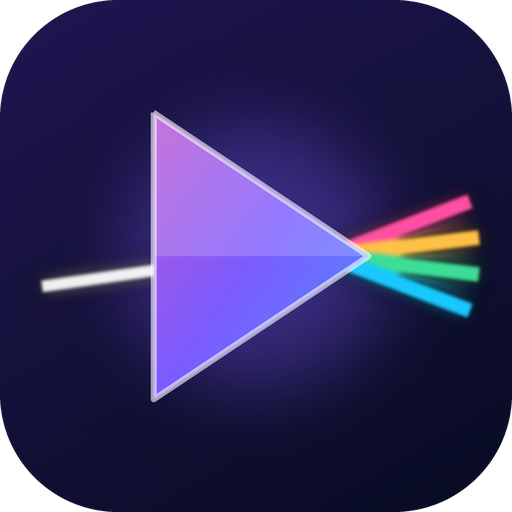
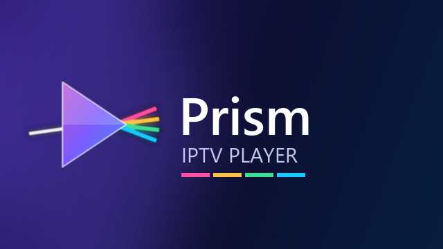

# Prism IPTV



A remote-first IPTV player for **Google TV / Android TV**, **Amazon Fire TV** and **Android phones and tablets**.
It plays the M3U playlists or Xtream Codes logins you already have.

> **Player only.** Prism IPTV ships with no channels, playlists or content. You need your own IPTV subscription or playlist.



## Download

**[⬇ Download the latest APK](https://github.com/haimairdataiot/Prism.IPTV/releases/latest/download/PrismIPTV.apk)** · [All releases](https://github.com/haimairdataiot/Prism.IPTV/releases)

The same APK works on TVs, Fire TV and phones. It needs Android 7.1 / Fire OS 6 or newer.

Direct link, handy for typing on a TV:

```
https://github.com/haimairdataiot/Prism.IPTV/releases/latest/download/PrismIPTV.apk
```

## Install

Prism IPTV isn't in the Play Store or Amazon Appstore, so you install the APK yourself ("sideloading"). This only has to be done once: after that the app updates itself.

### Amazon Fire TV (Fire TV Stick, Cube, Fire TV smart TVs)

1. **Turn on developer options.** Go to *Settings → My Fire TV → About*, select your device name (e.g. *Fire TV Stick*) **7 times** until it says you're a developer. On older models *Developer options* is already there.
2. Install the free **Downloader** app (by AFTVnews) from the Amazon Appstore: search for "Downloader".
3. Allow it to install apps: *Settings → My Fire TV → Developer options → Install unknown apps → Downloader → On*.
4. Open Downloader. In the address box, type the direct link above and select **Go**.
5. When the download finishes, select **Install**, then **Open**. You can let Downloader delete the APK file afterwards to save space.

### Google TV / Android TV (Chromecast with Google TV, Google TV Streamer, Sony, TCL, Hisense, NVIDIA Shield…)

1. **Turn on developer options.** Go to *Settings → System → About*, scroll to **Android TV OS build** and press OK on it **7 times**.
2. Install **Downloader** (by AFTVnews) from the Google Play Store on the TV.
3. Open Downloader, type the direct link above and select **Go**.
4. When Android asks, allow Downloader to install unknown apps (*Settings* → turn on **Allow from this source**), press BACK, then select **Install** and **Open**.

The app appears in the *Apps* row. To move it to your favourites, long-press it and choose *Add to favourites*.

### Android phone or tablet

1. On the phone, open the [download link](https://github.com/haimairdataiot/Prism.IPTV/releases/latest/download/PrismIPTV.apk) in Chrome.
2. Open the downloaded file (from the notification or the *Downloads* app).
3. When Android asks, allow Chrome to install unknown apps, go back and select **Install**.

The app runs full screen in landscape. Tap selects, long-press opens menus, and in the player you tap the video for on-screen controls.

### Using a computer (adb)

If you already use adb: enable *Network debugging* / *ADB debugging* in the TV's developer options, then

```bash
adb connect <tv-ip-address>:5555
adb install -r PrismIPTV.apk
```

Accept the debugging prompt on the TV the first time you connect.

## First start

1. Open Prism IPTV and select **Add playlist**.
2. Choose **M3U URL**, **Xtream Codes** (server, username, password) or **Local file**.
3. Typing on a remote is slow: use **Transfer from phone** on the Home screen instead. It shows a QR code; open it on a phone on the same Wi-Fi and paste the playlist URL or login there.

If your provider gave you a `get.php?username=…&password=…` link, paste it as an M3U URL: the app offers to add it as an Xtream login, which also brings in movies, series, catch-up and the TV guide.

## Remote control basics

| Button | In the menus | Watching live TV |
|---|---|---|
| ▲ ▼ | Move | Next / previous channel |
| OK | Select | Pause / resume, shows the seek bar |
| ◀ ▶ | Move | Rewind / forward while the seek bar shows; otherwise ◀ channel list, ▶ options |
| Hold OK (or ☰ Menu) | Options for the item (favourite, edit…) | |
| BACK | Go back | Close overlay / leave the player |
| 0–9 | Type a channel number | Type a channel number |

## Updates

The app checks this page's latest release when it starts (at most every 6 hours) and offers **Update / Later / Skip this version**. You can also check any time from **Settings → Check for updates**.

The first update asks you to allow Prism IPTV to install apps: turn it on, press BACK and the update continues. On Fire TV the switch is under *Settings → My Fire TV → Developer options → Install unknown apps → Prism IPTV*.

Every download is verified (SHA-256), and Android only accepts an update signed by the same developer key as the installed app.

## Features

* M3U / M3U8 URLs, Xtream Codes logins and local M3U files; several playlists side by side
* Live TV with groups, logos, now/next, favourites and recently watched
* Full TV guide (XMLTV) and catch-up for providers that support it
* Movies and series with posters, seasons, resume points and autoplay of the next episode
* Pause and short rewind on live TV, audio and subtitle tracks, aspect ratio, video quality
* Search across channels, movies, series and the guide
* Backup and restore of all playlists and settings (to a file, a URL or your phone)
* Works entirely with the D-pad, OK and BACK; also touch on phones and tablets

## Troubleshooting

| Problem | Try |
|---|---|
| "App not installed" | An older copy signed differently is installed. Uninstall it first (back up your playlists from *Backup & restore*), then install again |
| Downloader says the page can't be reached | Check the link letter by letter, including `https://`. Some networks block GitHub downloads; try the phone or adb method |
| The playlist won't load | Open the URL in a browser to check it works. Some providers require a specific User-Agent: set it in the playlist editor |
| A channel only plays sound, or keeps reconnecting | The stream may be down or geo-blocked. Try it in VLC; if it works there but not in Prism IPTV, open an issue |
| Empty TV guide | In the playlist's page choose *Refresh guide*, or set an EPG / XMLTV URL in the playlist editor |

## Privacy

Prism IPTV has no accounts, ads or analytics. Your playlists stay on the device; it only connects to your playlist and guide providers, and to GitHub to check for updates (which you can turn off under *Settings → Updates*).

## License

See [LICENSE](LICENSE).
